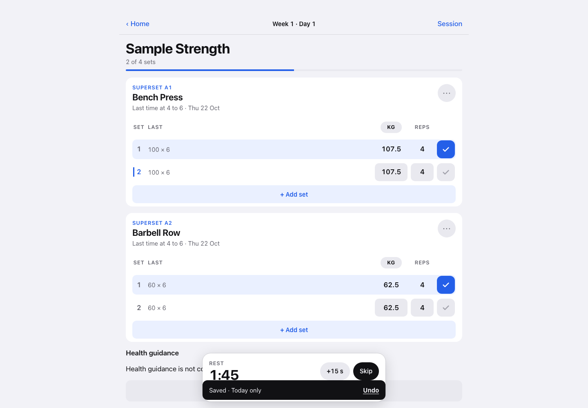
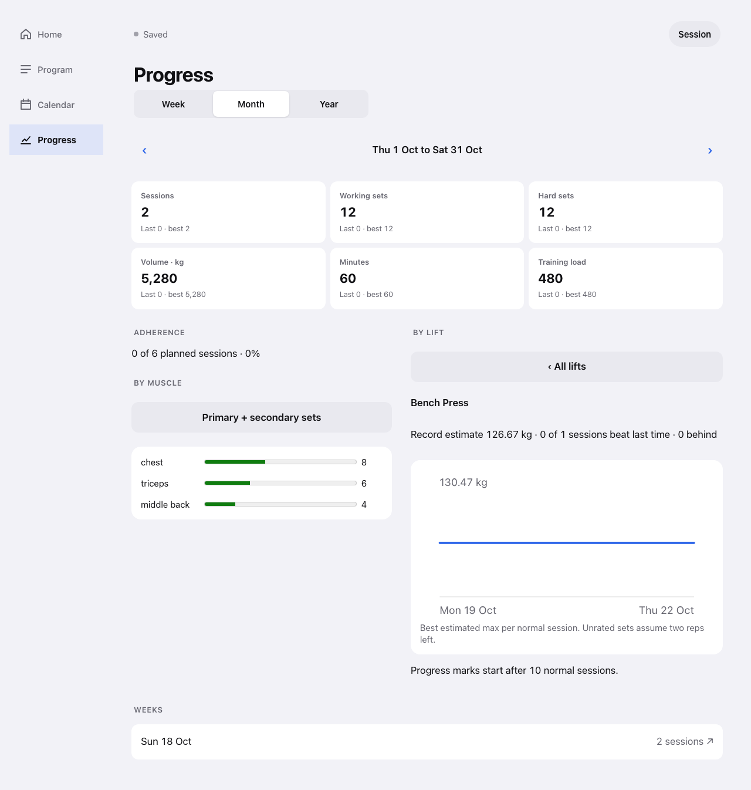

# Next Set

My workout tracker for logging sets and seeing progress.

**Status: in progress.** Compact exercise rows, blank rep and weight entries, and Progress charts are implemented. Health weight history is connected in the private release. A real iPhone workout test and import review remain.

- Log weight and reps beside the previous session's sets.
- Expand an exercise to enter blank reps and weights, resume a draft, or copy the previous set with Use last.
- Swipe an exercise to reveal Remove, with Undo.
- Keep workout dates through corrections and resume extra workouts after midnight.
- Open the next superset set on demand. Choose a stop reason when finishing.
- See local saves, pending sync, and the date range checked against the server.
- Resume unfinished entries and follow superset rounds.
- Find favorite exercises and read why a target was suggested.
- Filter lift progress and weekly work by body area, then open the recorded sets.
- See training activity over 4 weeks, 12 weeks, a year, or all history.
- See dated weight readings and a seven-day trend when Health is connected.





[Phone Progress view](progress-phone.png). [Progress with sample weight history](weight.png).

Screenshots use invented sample records. The working app and its data are private. The weight screenshot uses invented readings.

## Run locally

Use Node **24.21.0**.

```sh
npm ci
npm run build
npm start
```

Open `http://127.0.0.1:18081`. Create a program and add your exercises. The default database is `data/workout.sqlite`.

For a disposable demo with sample history:

```sh
npm run demo -- --dry-run
npm run demo
```

The command prints a local address. It uses a temporary database and removes it when you stop the process. It never opens the normal database.

Docker Compose also runs without another service or external network:

```sh
docker compose --dry-run up -d --build
docker compose up -d --build
```

The port binds to loopback. The named `training_data` and `training_backups` volumes retain the records. Do not remove them when updating.

## Private phone access

This is a single-user app. Put it behind a private HTTPS service, such as a private network proxy. It has no public account or sign-in system. Set `WORKOUT_APP_ORIGIN` to the exact HTTPS address. Do not expose the unauthenticated listener to the public internet.

For example, the default local setting is `WORKOUT_APP_ORIGIN=http://127.0.0.1:18081`. Keep private addresses and any integration credentials outside the source repository.

Open the app online first so the browser can save its files. Add it to the phone's Home Screen. Clearing browser storage removes unsynced records, drafts, and rest state. Synced records remain on the server.

The optional Health bridge supplies recovery guidance and dated weight readings when configured. Logging and Progress work without it. This is not an Apple Health integration.

### Optional Health weight connection

Health owns the readings; add or edit them there. Workout reads the versioned `/api/integration/v1/body-weight` route and saves the last validated response for offline display. The card shows when that copy was saved and whether it covers the selected dates. A current response with the connection disabled removes the saved copy.

Supply these values through the server environment or a private Compose override:

| Variable | Purpose |
|---|---|
| `HEALTH_INTEGRATION_URL` | Base URL reachable from the Workout server. |
| `HEALTH_WEIGHT_TOKEN` | Separate read-only weight credential, configured on both services. Do not reuse the advisory credential. |
| `INTEGRATION_SUBJECT_ID` | The same fixed subject on both services. |
| `HEALTH_APP_URL` | Optional private HTTPS address for the link to Health. |

The generic Compose file leaves this connection off. It does not supply a Health service. Keep credentials outside Git and the browser. The existing `HEALTH_ADVISORY_TOKEN` and `WORKOUT_INTEGRATION_TOKEN` keep their separate purposes.

The chart shows kg and retains each reading's original display unit in its data table. For several readings on one day, the daily point uses the last reading. The trailing seven-day mean needs at least two measured days. It does not create readings for missing days or change historical strength estimates. After deleting a reading in Health, reopen Progress while connected to refresh its saved copy.

## Check a change

```sh
python3 -m venv .venv
.venv/bin/pip install -r requirements-test.txt
.venv/bin/python -m playwright install chromium webkit
npm run build
PLAYWRIGHT_PYTHON=.venv/bin/python npm test
```

Tests use temporary databases and invented records. Linux browser setup can require `playwright install --with-deps`. Automated browser checks do not replace a physical phone trial.

The GitHub workflow checks builds, domain behavior, logging, and Progress. It does not publish or deploy. Deploy the same reviewed app files privately.

## Data and estimates

The server stores SQLite; the browser stores IndexedDB. No hosted database is required. Backups on the server's own disk do not protect against losing that machine. Keep and test a copy on another device.

Estimated strength uses recorded load, reps, and effort. Unrated sets assume two reps left. Body-area views retain separate exercises; they do not invent a combined muscle-strength score. Off sessions and provisional imports remain in the records but stay out of normal strength comparisons. Imported loads remain excluded until the import-review extension supplies approval metadata.

The source export excludes the private cache/review/import tools. You can create programs and exercises in the app. The optional exercise adapter includes no third-party dataset or images.

MIT license. Dependency licenses are included in `public/dependency-licenses.txt` and served with the app. No OpenGym code, ExerciseDB media, or proprietary program text is included.
